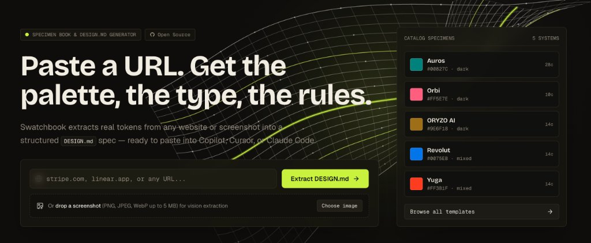

<div align="center">

# Swatchbook

**Turn any website or screenshot into a production-ready `DESIGN.md` spec for AI coding tools.**

Extract real colors, typography, spacing, and component patterns — deterministically compiled into Tailwind v4 `@theme` and CSS `:root` tokens.

[](https://nextjs.org/)
[](https://tailwindcss.com/)
[](https://www.typescriptlang.org/)
[](./LICENSE)
[](./CONTRIBUTING.md)

<br />

[Quick Start](#-quick-start) •
[Features](#-features) •
[AI UI Guide](#-how-to-generate-high-end-uis-with-ai) •
[Contribute a Template](#-contribute-a-design-template-zero-code-changes) •
[Guides](#-documentation--guides)

<br />



</div>

---

## ✨ Features

When using AI coding assistants like **Cursor**, **Claude Code**, or **GitHub Copilot**, generating UI often results in generic styling unless provided with concrete design tokens.

**Swatchbook** bridges this gap by extracting real design systems from any reference website or screenshot into an exhaustive **`DESIGN.md`** specification:

- ⚡ **URL Token Extraction** — Safely fetches HTML and linked stylesheets with strict SSRF protection, parsing CSS custom properties, hex frequencies, font stacks, border radii, and breakpoints into structured tokens.
- 👁️ **Screenshot Multimodal Vision** — Upload, drag-and-drop, or paste (`Cmd/Ctrl+V`) any screenshot (PNG, JPEG, WebP) to analyze color palettes, visual hierarchy, and component recipes with multimodal vision AI.
- 🎨 **Refero-Style Specimen Gallery** — Curated collection of production design systems (Auros Global, Orbi, Oryzo AI, Revolut, Yuga) with interactive swatches, type specimens, and live hover-scroll website previews.
- 🛠️ **Deterministic Tailwind v4 `@theme`** — CSS `:root` variables and `@theme` blocks are compiled directly in code from extracted tokens — zero hallucinated hex codes.
- 🌐 **Interactive 3D Parametric Mesh** — 60fps HTML5 Canvas wireframe background reacting smoothly to cursor movement with realistic perspective projection.
- 📋 **AI-Ready Coding Prompts** — One-click copy "Build a landing page with this spec" prompt tailored for your favorite coding assistant.
- 📱 **Interactive Lightbox & Live Previews** — Expand full-page website screenshots in an accessible native `<dialog>` lightbox and preview live UI mockups rendered with extracted tokens.

---

## 🚀 How It Works

```text
  [ Live URL or Screenshot ] 
              │
              ▼
   [ Style & Token Extractor ]  ──>  SSRF-Guarded Fetch + CSS AST Parser
              │
              ▼
    [ AI Spec Architect ]       ──>  Streams validated 16-section DESIGN.md
              │
              ▼
  [ Deterministic Quick Start ] ──>  Compiles exact Tailwind v4 @theme & :root CSS
              │
              ▼
  [ Ready for Cursor / Claude ] ──>  Paste into workspace & ship matching UI
```

---

## 🤖 How to Generate High-End UIs with AI

Once you extract or copy a `DESIGN.md` spec, how do you get the best possible UI from **Cursor**, **Claude Code**, **Copilot**, or **v0**?

### The 3-Step AI Workflow

1. **Wire Tokens into CSS:** Copy the `## Quick Start` block directly into your `app/globals.css` (Tailwind v4 `@theme inline` block). Your IDE will immediately autocomplete `bg-canvas`, `text-accent`, and `border-border`.
2. **Give Spec Context to Your AI:**
   - **Cursor:** Tag `@DESIGN.md` in Composer (`Cmd+I`) or configure `.cursor/rules/design.mdc`.
   - **Claude Code:** Add `All UI components MUST adhere strictly to DESIGN.md` into your `CLAUDE.md`.
   - **GitHub Copilot:** Tag `#file:DESIGN.md` in Copilot Chat.
   - **v0 / ChatGPT / Claude Web:** Click **"Copy 'build a landing page' prompt"** in Swatchbook and paste directly.
3. **Use the 4-Part Prompt Structure:**
   - (1) Role constraint &rarr; (2) Component requirements &rarr; (3) Explicit token mapping &rarr; (4) Negative constraints (anti-hallucination guardrails).

👉 **Read the comprehensive [AI UI Generation Guide](./docs/HOW_TO_USE_DESIGN_MD.md)** for copy-paste `.cursorrules`, Claude Code configs, and component-by-component recipes.

---

## ⚡ Quick Start

### 1. Clone & Install

```bash
git clone https://github.com/ArslanYM/swatchbook.git
cd swatchbook
pnpm install
```

### 2. Configure Environment

```bash
cp .env.example .env.local
```

Edit `.env.local` with your [OpenRouter](https://openrouter.ai/) credentials:

```bash
OPENROUTER_API_KEY=your_openrouter_api_key
OPENROUTER_MODEL_TEXT=nvidia/nemotron-3.5-lightning:free
OPENROUTER_MODEL_VISION=openrouter/free
OPENROUTER_FALLBACK_MODEL=openrouter/free
```

> [!NOTE]
> Browsing templates (`/templates`) and inspecting specimens (`/templates/[slug]`) works **100% offline with zero API keys**. An OpenRouter key is only required for active generation in `/generate`.

### 3. Start Development Server

```bash
pnpm dev
```

Open [http://localhost:3000](http://localhost:3000) to view the application.

---

## 🤝 Contribute a Design Template (Zero Code Changes!)

Have a favorite website or design system you love? Adding it to Swatchbook takes less than 5 minutes:

1. Create a markdown file: `content/templates/<slug>.md`
2. Follow the 16-section `DESIGN.md` spec structure (colors, typography, components, do's & don'ts).
3. Optionally add preview screenshots to `public/previews/<slug>/`.
4. Open a Pull Request!

👉 **Read the full [Template Contribution Guide](./CONTRIBUTING.md#contributing-a-design-template)** to get started.

---

## 🛠️ Tech Stack

| Layer | Technology |
| --- | --- |
| **Framework** | [Next.js 16.4](https://nextjs.org/) (App Router, Turbopack, React 19) |
| **Styling** | [Tailwind CSS v4](https://tailwindcss.com/) with `@theme inline` & [shadcn/ui](https://ui.shadcn.com/) |
| **Typography** | Bricolage Grotesque & Geist Font Family |
| **Animation** | [Framer Motion](https://www.framer-motion.com/) & Canvas 3D Parametric Mesh |
| **LLM Provider** | [Vercel AI SDK](https://sdk.vercel.ai/) with OpenRouter |
| **Testing** | [Vitest](https://vitest.dev/) (30/30 unit & route integration tests) |

---

## 💻 Available Scripts

```bash
pnpm dev              # Start development server with Turbopack
pnpm build            # Build optimized production bundle
pnpm start            # Run production server
pnpm lint             # Run ESLint checks
pnpm typecheck        # Run TypeScript strict checks
pnpm test             # Run Vitest test suite
pnpm capture-previews # Automated Playwright screenshot capture utility
```

---

## 📚 Documentation & Guides

- 🤖 **[AI UI Generation Guide](./docs/HOW_TO_USE_DESIGN_MD.md)** — Best practices for prompting Cursor, Claude Code, Copilot, and v0 with DESIGN.md tokens.
- 📖 **[Contribution Guide](./CONTRIBUTING.md)** — Step-by-step instructions for adding templates and submitting code.
- 🛡️ **[Security Policy](./SECURITY.md)** — SSRF defense architecture and vulnerability reporting guidelines.
- 📜 **[Code of Conduct](./CODE_OF_CONDUCT.md)** — Community standards and participation pledge.
- 📄 **[License: MIT](./LICENSE)** — Free for personal and commercial open-source use.

---

<div align="center">
  <sub>Built with ❤️ by the open-source community. If you find Swatchbook helpful, consider starring the repo!</sub>
</div>
